# Antigravity Android Layer Architecture (`app/`)

The `app/` module is the native Android host shell for **Antigravity v2.4+ (Android ARM64, Bionic + Glibc userspace, `targetSdk 28` / `minSdk 24`)**.

It manages launching and supervising the Go `language_server` core, providing a hardened Chromium WebView UI container, running the local HTTP System Gateway Server, and integrating with Android OS features (notifications, wake locks, clipboard, storage, Root, and Shizuku/`rish`).

---

## 1. Component Architecture

```mermaid
graph TD
    subgraph UI_Layer ["UI Layer"]
        LDA["LauncherDarkActivity / LauncherLightActivity"] --> MA["MainActivity"]
        MA --> SC["SplashController (NativeSplashDotsView / Lazy WebView)"]
        MA --> UC["UpdateChecker (GitHub Releases 24h Check)"]
        MA --> WVH["WebViewHost (AgyWebView / ClipboardImageReader)"]
        WVH --> AWVC["AgyWebViewClient (OAuth & Asset Interceptor)"]
        WVH --> AWCC["AgyWebChromeClient (Console, Files, Popups)"]
        WVH --> LAS["LocalAssetServer (In-process files/web/ server)"]
        WVH --> AHI["AppHtmlInjector (Injects __APP_CONFIG__ & tokens)"]
    end

    subgraph Bridge_Layer ["Bridge & Security"]
        MA --> AB["AndroidBridge (JavascriptInterface 'Android')"]
        AB --> UB["UiBridge (onUiReady, fatal errors, desktop mode)"]
        AB --> TB["ThemeBridge (Theme synchronization)"]
        AB --> EB["EngineBridge (Core status and parameters)"]
        AB --> ECJ["EngineConfigJson (Config serialization)"]
    end

    subgraph Core_Layer ["Background Services & Supervision (Core Layer)"]
        CSS["CoreServerService (Foreground Service + WakeLock)"]
        CSS --> CPS["CoreProcessSupervisor (Core lifecycle management)"]
        CPS --> CL["CoreLauncher (Phase 1 setup & process launch)"]
        CPS --> CRP["CoreReadyProbe (Probes https://127.0.0.1:port)"]
        CPS --> OUW["OpenUrlWatcher (Captures OAuth/URL from stdout)"]
        CPS --> LS["language_server process (Glibc / ARM64)"]
        CSS --> AGD["agy-daemon background CLI task engine"]
    end

    subgraph Gateway_Layer ["System Gateway"]
        CSS --> SGS["SystemGatewayServer (HTTP Server on 127.0.0.1:45160/45161)"]
        SGS --> GD["GatewayDispatcher"]
        GD --> NH["NotificationHandler (Task & alert channels)"]
        GD --> BH["BrowserHandler (External browser launcher)"]
        GD --> PH["PowerHandler (Partial WakeLock control)"]
        GD --> CH["ClipboardHandler (System clipboard read/write)"]
        GD --> DH["DeviceHandler (Battery, network, vibrate, toasts)"]
        GD --> EH["ExecHandler (Local shell & rish execution)"]
    end

    subgraph Platform_Layer ["Android OS Integration"]
        AFP["AppFileProvider (${applicationId}.fileprovider)"]
        DCH["DocumentsContractHelper (Resolves SAF URIs to /storage/...)"]
        SHB["ShizukuBridge / RishExecutor (ADB Shell uid=2000)"]
        RB["RootBridge / RootResilience (uid=0, Doze/OOM)"]
        LIS["LauncherIconSwitcher (Dynamic launcher icon switching)"]
    end

    WVH -.->|JS Call| AB
    LS -.->|Stdout Stream| OUW
    AGD -.->|JSON over HTTP| SGS
    NH -.->|Android Notifications| Platform_Layer
    EH -.->|Elevated Shell| SHB
```

---

## 2. Core Subsystems

### 2.1. Background Services & Core Supervision (`com.agy.core`)

The core binary (`language_server`) is compiled for Linux/Glibc and runs on Android via the custom `libloader.so` loader with `liblse_compat.so` instruction emulation.

- **`CoreServerService`**:
  - Runs as a `dataSync` `ForegroundService` with a clickable notification (`ForegroundNotification` using `FLAG_ACTIVITY_SINGLE_TOP | FLAG_ACTIVITY_CLEAR_TOP | FLAG_IMMUTABLE`).
  - Manages the CPU WakeLock (`WakeLockHolder`, `PARTIAL_WAKE_LOCK`) to keep agent runs alive with the screen off.
  - Starts/stops `agy-daemon` with full environment variables (`HOME`, `PREFIX`, `LD_LIBRARY_PATH`), checks exit/failure codes, and prunes stale dead-PID `hub_*.json` files on startup.
- **`CoreLauncher`**:
  - Runs Phase 1 extraction/verification and launches `language_server`.
  - Uses `killOrphanCoreProcesses()` to scan `/proc` and terminate stale orphan `language_server` processes before launch, preventing `EADDRINUSE` on fixed loopback ports (`45157`/`45158`).
- **`CoreProcessSupervisor`**:
  - Runs `language_server` on `CoreServerThread`, streaming stdout to `files/logs/core.log` (buffered in-session 1.5 MB rotation) and stderr to `files/logs/core_stderr.log` (512 KB cap) via single-pass `SensitiveDataRedactor` and `LogRingBuffer` (`ArrayDeque`), with `CoreRuntimeState` listener notifications eliminating steady-state UI polling.
  - Implements exponential backoff restarts (`CoreRestartPolicy`, up to 3 restarts; crash counter resets after `SUSTAINED_READY_MS` = 60 s).
  - Writes fatal crash snapshots via `CrashRecorder` (pruned to the newest 10 `crash_*.json` files).
- **`CoreEnvironment`**:
  - Sets RAM-scaled `GOMEMLIMIT` (`448MiB`–`1536MiB`) and `GOGC`, gates `--enable_sidecars` at `>= 5.5 GB` RAM (protecting 4 GB mid-range devices), and applies granular ARMv8 `GODEBUG` feature flags so hardware AES/SHA stays active when LSE `atomics` are absent.
- **`CoreReadyProbe`**:
  - Polls local HTTPS readiness up to 60 seconds (`READY_TIMEOUT_MS = 60000`) for slow ARMv8.0-A cold starts.
  - Verifies exact SHA-256 leaf pinning against `@raw/agy_core_cert` via `matchesCert()`, invoked by `AgyWebViewClient.onReceivedSslError` alongside `TrustedCoreOrigin.matches()`.
- **`OpenUrlWatcher`**:
  - Captures Google OAuth redirects (`AGY_OPEN_URL=`, `ANTIGRAVITY_OPEN_URL:`, and `accounts.google.com` URLs) from core stdout and opens them in the external browser via `CustomTabLauncher` (also handles the permission-protected `com.agy.ACTION_OPEN_URL` broadcast). `CustomTabLauncher` (and `UriDispatcher`) runs `GoogleOAuthUrlRewriter.ensureAccountChooser()` on `https://accounts.google.com/o/oauth2/.../auth` URLs so `prompt` always includes `select_account` (preserving `consent` if present) and `login_hint`/`authuser` are stripped without altering other encoded query parameters.

### 2.2. WebView, UI & Startup Flow (`com.agy.ui`)

- **Two-Phase Startup (`SplashController` + Ready Flow)**:
  1. `MainActivity` launches with a lightweight native Canvas overlay (`NativeSplashDotsView`), avoiding an extra Chromium WebView (~40 MB RAM saved).
  2. In parallel, `CoreServerService` unpacks/starts the core and waits for `CoreReadyProbe`.
  3. Once ready, `WebViewHost.loadApp()` injects HTML and configuration.
  4. The splash dismisses when JavaScript signals `window.Android.onUiReady()` cleanly, preventing blank flashes.
- **`LocalAssetServer`**:
  - Intercepts `shouldInterceptRequest` in `AgyWebViewClient` for same-origin `https://127.0.0.1:<port>/*`, serving static `files/web/*` assets in-process while forwarding RPC/WebSocket calls (`/exa.*`, `/jetski.*`, streaming) to the core.
- **`AppHtmlInjector`**:
  - Injects a strict `Content-Security-Policy` into `<head>` along with `window.__APP_CONFIG__`, `window.__AG_ENDPOINTS__`, `window.__AG_CSRF__`, and the per-session cryptographic `blobBridgeToken`.
- **File Picker & Downloads (`FileDownloader`)**:
  - Handles HTTP downloads and Base64 blobs (`saveBlob`), SAF file/folder picking (`takePersistableUriPermission`), and cleanup of pending temp files.

### 2.3. System Gateway (`com.agy.gateway`)

`SystemGatewayServer` binds strictly to `127.0.0.1:45160` (release) / `127.0.0.1:45161` (dev, `+2` port fallback), writes `files/logs/gateway.port`, and writes a per-boot 64-hex CSPRNG bearer token (`X-AGY-Token` / `Authorization: Bearer`) to `files/logs/gateway.token` (`0600`). Requests missing a valid token receive `401 Unauthorized`.

| Endpoint / Action | Handler | Description |
| :--- | :--- | :--- |
| `notify` | `NotificationHandler` | Posts, updates, and cancels Android notifications on `agy_tasks` and `agy_alerts` (`IMPORTANCE_HIGH` with sound/vibration/badge and `EXTRA_CONVERSATION_ID` tap deep-linking). |
| `open_url` | `BrowserHandler` | Opens external URLs and documents via `UriDispatcher`. |
| `wakelock` | `PowerHandler` | Acquires and releases named partial wake locks for long-running scripts. |
| `clipboard` / `clipboard_set` | `ClipboardHandler` | Reads and writes the system clipboard safely on the UI thread. |
| `system_info` | `DeviceHandler` | Reports battery, charging state, network type, RAM, and disk free space. |
| `vibrate` | `DeviceHandler` | Triggers haptic feedback for a specified duration. |
| `toast` | `DeviceHandler` | Displays native Android Toast messages. |
| `exec` | `ExecHandler` | Executes commands via `/system/bin/sh` or Shizuku `rish` with `MAX_CONCURRENT_EXECS = 2`, 256 KB per-stream cap, `destroyForcibly()` timeouts, and `GIT_SSL_CAINFO`. (Native root runs via `agy-root`/`su`/`sudo` in the shell, not over HTTP.) |
| `root_status` | `GatewayDispatcher` / `RootBridge` | Inspects native root (`su`, KernelSU/bakaSU/Magisk/APatch, `-mm`) and `rish` + `rish_shizuku.dex` availability. |
| `/gateway/status` | `SystemGatewayServer` | Health check status endpoint. |
| `/gateway/logs` | `SystemGatewayServer` | Reads recent lines from the in-memory ring buffer. |
| `/gateway/commands` | `SystemGatewayServer` | Lists recently executed gateway commands and exit codes. |
| `/gateway/crash` | `SystemGatewayServer` | Returns the latest crash diagnostic snapshot. |

### 2.4. Bridge Security (`com.agy.bridge`)

`AndroidBridge` exposes a tightly scoped `@JavascriptInterface`:

- **Token-Gated Mutation APIs:** State-mutating and sensitive methods (`onUiReady`, `onUiError`, `openDirectoryPicker`, `setTheme`, `setThemeByUser`, `onVisualThemeChanged`, `setDesktopMode`, `saveBlob`, `notifyAgentEvent`, `hasClipboardImage`, `requestClipboardImagePaste`, `readClipboardImage`, `startGitHubDeviceAuth`, `pollGitHubDeviceAuth`, `openGitHubDevicePage`, `copyGitHubDeviceCode`, `getSavedAccounts`, `syncCurrentAccount`, `activateSavedAccount`, `removeSavedAccount`, `restartCoreForAccountSwitch`) require `blobBridgeToken` verified with constant-time `MessageDigest.isEqual`. GitHub Device Flow (`com.agy.oauth.GitHubDeviceAuth`) talks strictly to `https://github.com/login/device/code` and `https://github.com/login/oauth/access_token`, locks browser launch to `https://github.com/login/device`, and never logs access tokens or device codes.
- **Account Vault (`com.agy.oauth.AccountVaultStore`):** Persists sanitized profile metadata alongside owner-only (`0600`) snapshots of `jetski-standalone-oauth-token` in `files/.gemini/agy-account-vault.json`. Raw access/refresh tokens stay strictly in Java/disk and are never returned over `AndroidBridge`.
- **Execution Isolation:** Arbitrary shell and root execution are excluded from `AndroidBridge`. Native root (`RootBridge`, `RootResilience`) stays in Java and shell helpers (`agy-root`, `su`, `sudo`, `agy-sys`), and `SplashController` destroys its `WebView` (`destroy()`) on `dismiss()`.

### 2.5. Dynamic Launcher Icons & Themes (`com.agy.theme`)

- **Dual Launcher Activity Pattern:** Uses `LauncherDarkActivity` (`@style/SplashThemeDark`) and `LauncherLightActivity` (`@style/SplashThemeLight`) extending `MainActivity` instead of `activity-alias` so Android 12+ system splash screens match the chosen app theme rather than system dark/light mode.
- **`LauncherIconSwitcher`:** Calls `setComponentEnabledSetting(..., DONT_KILL_APP)` only when backgrounded (`onStop`) so active WebView sessions are never interrupted.

---

## 3. Audit Fixes & Improvements

### 3.1. Memory Leaks Resolved
1. **`MainActivity` leak via `UiBridge`:** Calls `androidBridge.setActivity(null)` in `MainActivity.onDestroy()` and stores `WeakReference<MainActivity>` in `UiBridge` and `AndroidBridge`.
2. **Popup WebView leak in `PopupWindowHandler`:** Calls `popup.destroy()` immediately after forwarding `window.open` URLs via `oauth.openInBrowser()`.
3. **Static Base64 retention in `FileDownloader`:** Spills pending blobs to `cacheDir` temp files and cleans them on refusal, completion, `MainActivity.onDestroy()` (`clearPendingTask()`), and startup (`pruneStalePendingBlobsAsync()`).
4. **Released `WakeLock` buildup in `PowerHandler`:** Prunes `!lock.isHeld()` entries via `cleanupUnheld()` on status checks and acquires.
5. **Bounded header parsing in `SystemGatewayServer`:** Caps `readHeaderLine` at 8192 bytes to prevent header-flood OOMs.

### 3.2. Dead Code Removed
Removed unused classes: `ShellBridge`, `ExternalUrlBridge`, `NotificationBridge`, `ChmodRunner`, `AuthReloader`, `AuthTokenPoller`, `DeepLinkForwarder`, `SplashLoadingHtml`, `LoopbackHost`, and `PackageInspector`.

### 3.3. Path & IPC Hardening
- **`ExecHandler` + `rish` integration:** Locates `$PREFIX/bin/rish` / `files/runtime/bin/rish`, exports `RISH_APPLICATION_ID`, and strips conflicting `LD_LIBRARY_PATH`.
- **Dynamic external storage resolution:** Replaced hardcoded `/storage/emulated/0/` in `DocumentsContractHelper` and `LogExporter` with `Environment.getExternalStorageDirectory().getAbsolutePath()` for multi-user/Work Profile compatibility.
- **`AppFileProvider` path validation:** Validates canonical paths (`getCanonicalPath()`) against sandbox roots (`filesDir`, `cacheDir`, `dataDir`, external storage) before serving URIs.
- **WebView Resilience & Lifecycle (`AgyWebViewClient`, `WebViewFactory`, `AppLifecycle`):**
  - Configures `RENDERER_PRIORITY_BOUND` (`waivedWhenNotVisible = true`) and handles `onRenderProcessGone` by destroying and recreating the `WebView` seamlessly instead of crashing on mid-range LMKD renderer kills.
  - Caches canonical asset paths in `LocalAssetServer`, debounces/dedupes DNS writes in `NetworkMonitorHolder`/`NetworkConfigWriter`, and trims WebView memory on `TRIM_MEMORY_RUNNING_LOW`/`CRITICAL` and `TRIM_MEMORY_BACKGROUND`.
